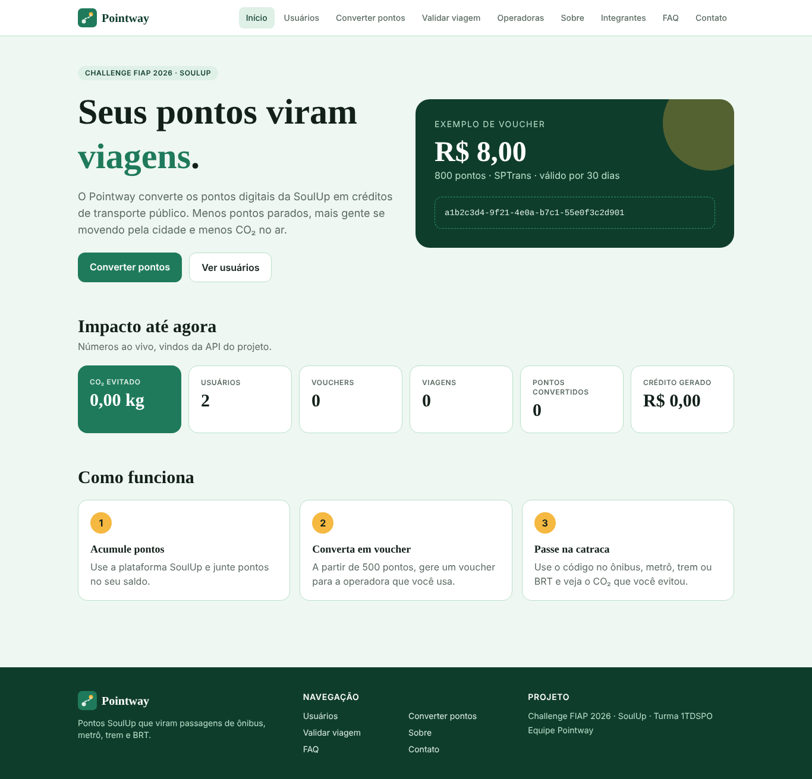
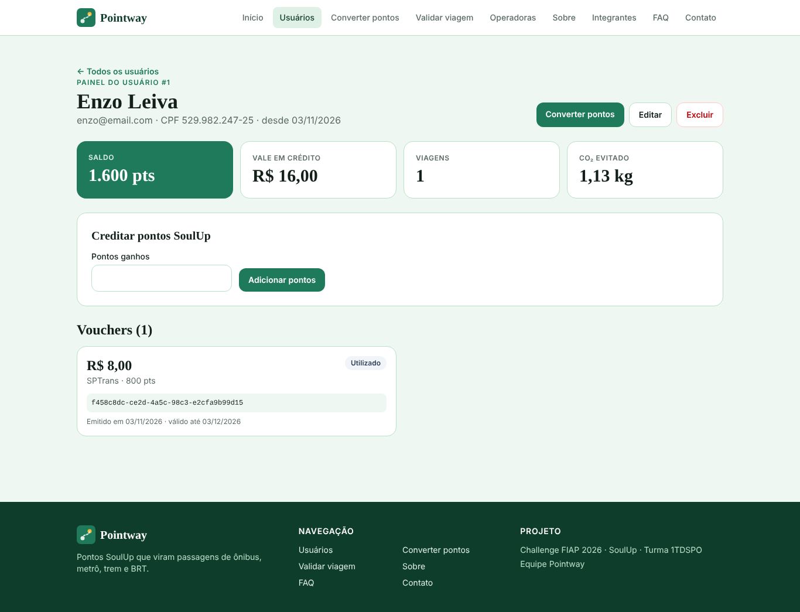
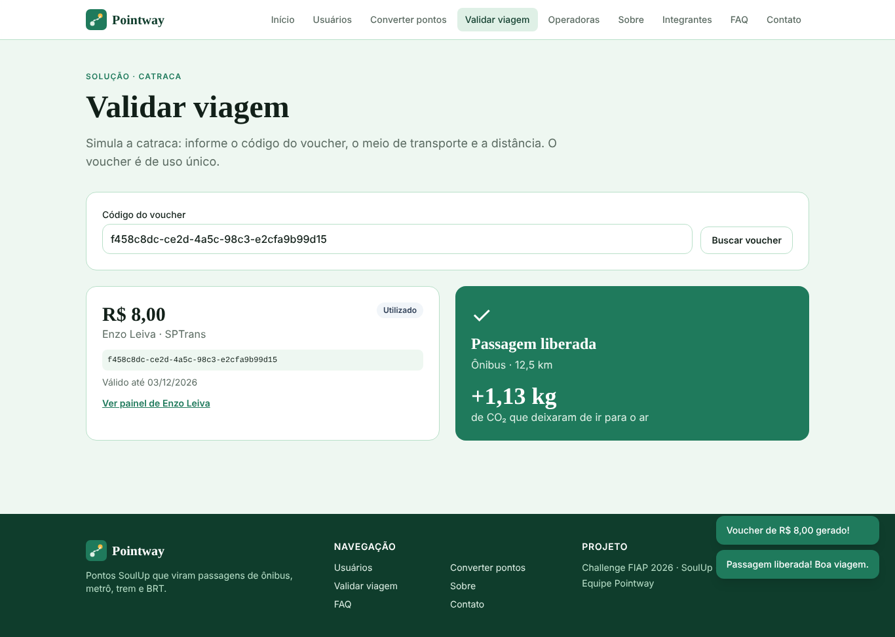
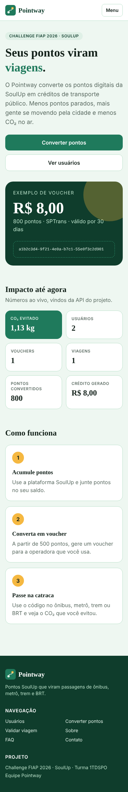
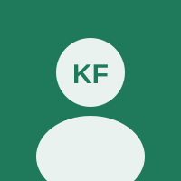
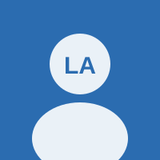

<p align="center"></p>

# Pointway — Front-End (Sprint 4)

**Seus pontos viram viagens.** O Pointway converte os pontos digitais da plataforma **SoulUp** em créditos de
transporte público (ônibus, metrô, trem e BRT), entregues como voucher digital. Cada viagem validada mostra quanto
CO₂ deixou de ser emitido.

Este repositório é a aplicação web (SPA) do projeto, feita em **React + Vite + TypeScript + Tailwind CSS**, que
consome a **API RESTful em Java (Spring Boot)** desenvolvida na disciplina de Domain Driven Design Using Java.

> Challenge FIAP 2026 · SoulUp · Turma 1TDSPO · Equipe Pointway

---

## Como usar

| Item | Link |
|---|---|
| Repositório GitHub | https://github.com/enzoleiva2008-blip/pointway-front |
| Vídeo no YouTube | https://youtu.be/SEU-VIDEO |
| Site publicado na Vercel | https://pointway-front.vercel.app|
| API Java publicada (Render) | https://pointway-api.onrender.com |
| Repositório da API Java | https://github.com/enzoleiva2008-blip/pointway-api |

> A API usa o plano gratuito do Render: no primeiro acesso ela pode levar até 1 minuto para "acordar".
> O site mostra uma mensagem de carregamento enquanto isso.

### Rodar no computador
Pré-requisito: **Node.js 20+**.

```bash
npm install          # instala as dependências
npm run dev          # abre em http://localhost:5173
npm run build        # gera a versão de produção em /dist
```

Por padrão o site usa a API publicada. Para apontar para outra (ex.: a API rodando na sua máquina), copie
`.env.example` para `.env` e altere:

```
VITE_API_URL=http://localhost:8080
```

### Roteiro rápido de uso
1. **Usuários** → `+ Novo usuário` para cadastrar (POST) e clique no cartão para abrir o painel.
2. **Converter pontos** → escolha usuário, operadora e pontos (mínimo 500) e gere o voucher (POST).
3. **Usar na catraca** → informe o meio de transporte e a distância; a viagem é registrada e o CO₂ calculado (POST).
4. No **painel do usuário** dá para creditar pontos (PATCH), editar (PUT), cancelar voucher e excluir (DELETE).

---

## Imagens

| Início | Painel do usuário |
|---|---|
|  |  |

| Validação na catraca | Celular |
|---|---|
|  |  |

---

## Tecnologias utilizadas
- **React 19** com hooks (`useState`, `useEffect`, `useContext`, `useMemo`, `useCallback`)
- **Vite 6** (build e servidor de desenvolvimento)
- **TypeScript** (interfaces, union types, intersection types e tipagem das respostas da API)
- **Tailwind CSS 4** (estilização e responsividade com `sm:`, `md:`, `lg:`, `xl:`)
- **React Router 7** (rotas estáticas e dinâmicas)
- **Fetch API** nativa (sem Axios)
- **Vercel** (deploy do front) · **Render + Aiven MySQL** (deploy da API)
- **Git / GitHub** (versionamento)

---

## Páginas e rotas

| Rota | Página | Tipo |
|---|---|---|
| `/` | Início, com indicadores ao vivo da API | estática |
| `/usuarios` | Lista, busca e cadastro de usuários | estática |
| `/usuarios/:id` | Painel do usuário (editar, creditar pontos, vouchers, excluir) | **dinâmica** |
| `/converter` | Conversão de pontos em voucher | estática |
| `/catraca` e `/catraca/:codigo` | Validação do voucher e registro da viagem | estática / **dinâmica** |
| `/operadoras` | Operadoras parceiras, com filtro por cidade | estática |
| `/sobre` | Sobre o projeto | estática |
| `/integrantes` e `/integrantes/:rm` | Equipe e perfil de cada integrante | estática / **dinâmica** |
| `/faq` | Perguntas frequentes | estática |
| `/contato` | Formulário de contato | estática |
| `*` | Página 404 com redirecionamento automático | — |

Parâmetros inválidos (ex.: `/usuarios/abc` ou um RM inexistente) **redirecionam** para a lista com uma mensagem.

### Endpoints da API consumidos

| Verbo | Endpoint | Onde |
|---|---|---|
| GET | `/impacto` | Início |
| GET | `/usuarios`, `/usuarios/{id}`, `/usuarios/{id}/resumo` | Usuários, painel, conversão |
| POST | `/usuarios` | Cadastro |
| PUT | `/usuarios/{id}` | Editar usuário |
| PATCH | `/usuarios/{id}/pontos` | Creditar pontos |
| DELETE | `/usuarios/{id}` | Excluir usuário |
| GET | `/operadoras?cidade=` | Operadoras, conversão |
| GET | `/vouchers?usuarioId=`, `/vouchers/codigo/{codigo}` | Painel, catraca |
| POST | `/vouchers` | Converter pontos |
| DELETE | `/vouchers/{id}` | Cancelar voucher |
| GET | `/modais` | Catraca (fator de CO₂) |
| POST | `/viagens` | Validar viagem |

Toda tela que usa a API trata **carregando**, **erro** (com botão "Tentar de novo") e **lista vazia**. As mensagens de
erro da API (ex.: "Saldo insuficiente") aparecem para o usuário em avisos na tela.

---

## Estrutura de pastas

```
pointway-front/
├── public/
│   ├── favicon.svg
│   └── integrantes/          # fotos dos integrantes
├── docs/                     # imagens usadas neste README
├── src/
│   ├── components/           # Header, Footer, Layout, estados (carregando/erro/vazio), formulários, UI
│   ├── context/              # AvisoContext (mensagens globais com useContext)
│   ├── data/                 # conteúdo fixo: integrantes e FAQ
│   ├── hooks/                # useApi (GET com estados de carregando/erro/sucesso)
│   ├── pages/                # uma página por rota
│   ├── routes/               # AppRoutes (rotas estáticas e dinâmicas)
│   ├── services/             # camada de integração com a API (fetch)
│   │   ├── api.ts            # função central de requisição + tratamento de erros
│   │   ├── usuarioService.ts
│   │   ├── voucherService.ts
│   │   ├── viagemService.ts
│   │   ├── geralService.ts
│   │   └── formatar.ts       # moeda, datas e nomes
│   ├── types/                # tipos e interfaces (api.ts, site.ts)
│   ├── App.tsx
│   ├── main.tsx
│   └── index.css             # Tailwind + cores da marca
├── .env.example
├── index.html
├── package.json
├── tsconfig*.json
├── vercel.json               # faz as rotas do React funcionarem na Vercel
└── vite.config.ts
```

---

## Autores e créditos

| Foto | Nome | RM | Turma | GitHub | LinkedIn |
|---|---|---|---|---|---|
|  | Kauã Fiuza | 572369 | 1TDSPO | [GitHub](https://github.com/) | [LinkedIn](https://www.linkedin.com/) |
|  | Lucas Almeida | 572499 | 1TDSPO | [GitHub](https://github.com/) | [LinkedIn](https://www.linkedin.com/) |
|  | Enzo Leiva | 568877 | 1TDSPO | [GitHub](https://github.com/enzoleiva2008-blip) | [LinkedIn](https://www.linkedin.com/) |
|  | Matheus Segura | 570878 | 1TDSPO | [GitHub](https://github.com/) | [LinkedIn](https://www.linkedin.com/) |

Projeto desenvolvido para o Challenge FIAP 2026 em parceria com a SoulUp.

---

## Contato
- E-mail: contato@pointway.com.br
- Equipe Pointway · FIAP · Av. Paulista, 1106 · São Paulo, SP
- Ou pela página **Contato** do site.
